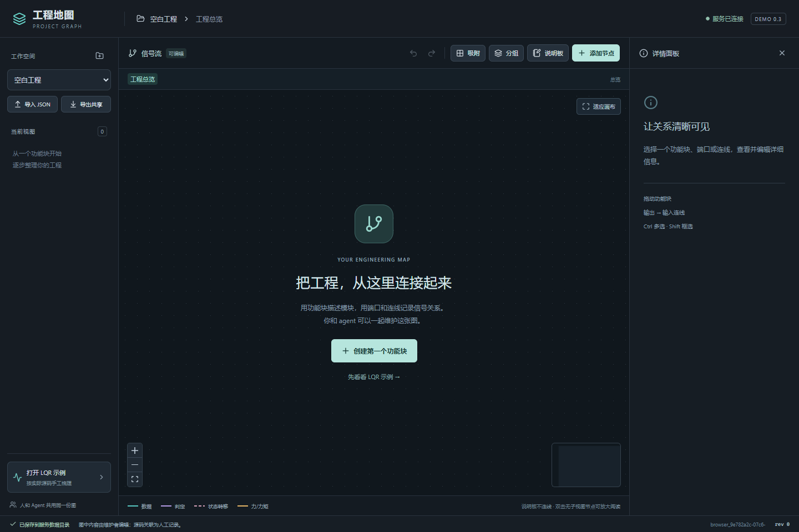
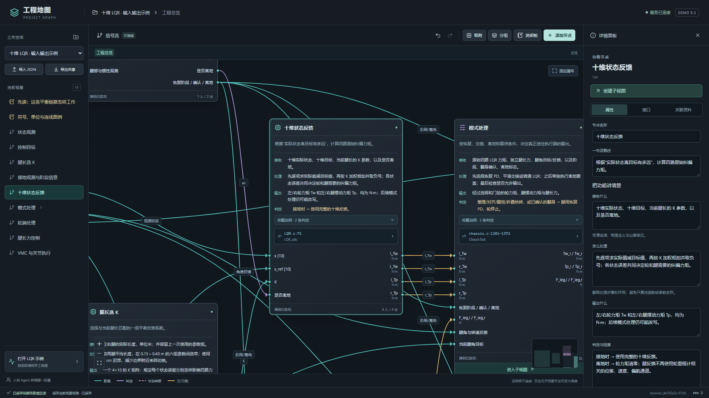
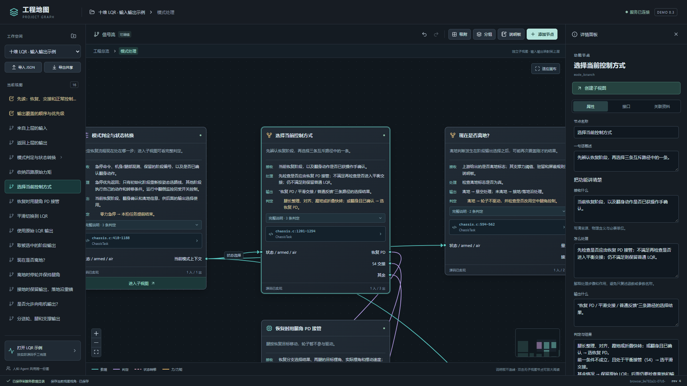
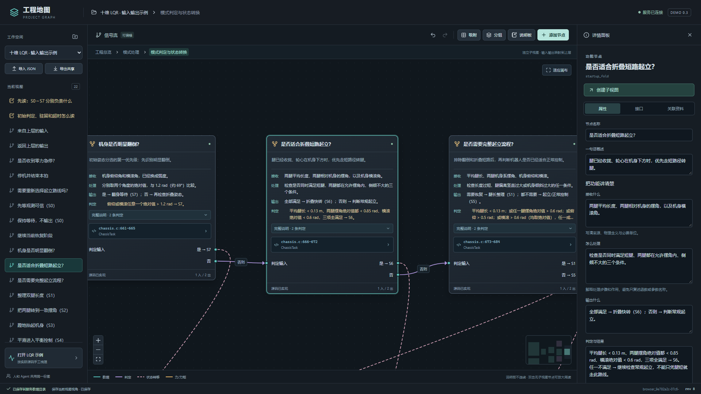
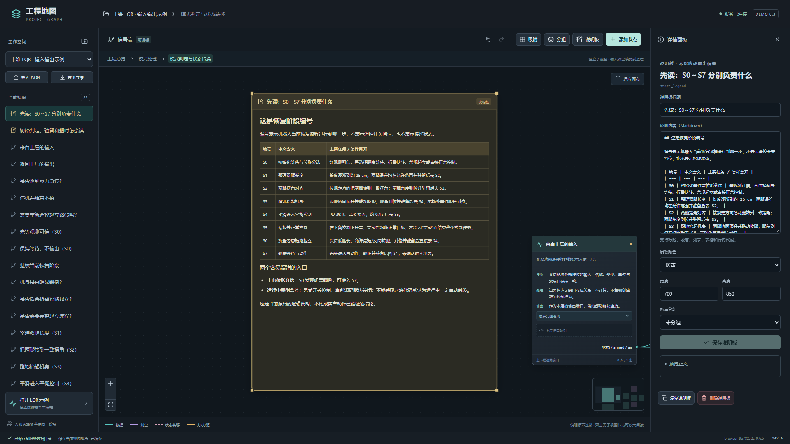
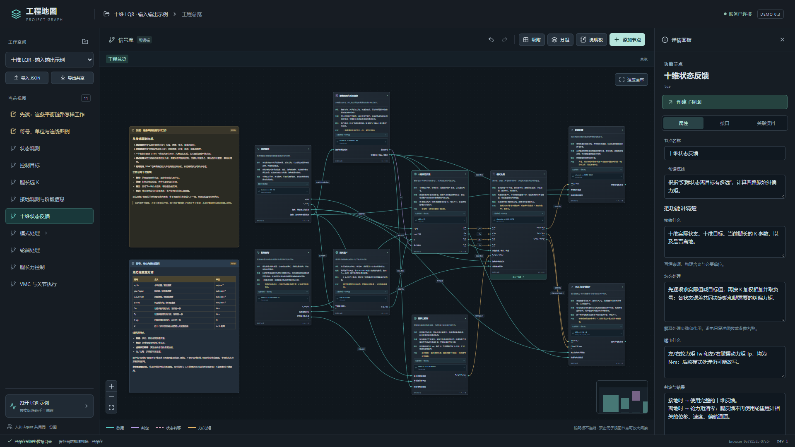

# 工程地图验证记录

## v0.4 块配色（2026-11-18）

- `npm test` 通过 21 项，新增配色字段合并、颜色校验、失败回滚、导出与重置检查。
- `npm run build` 通过类型检查和生产构建。
- Edge 浏览器通过 10 组场景。实际操作了右键、工具栏、预设、取色器和十六进制输入。检查了展开与收起的分组、浅色说明板文字、混合选择批量修改、撤销重做、导入导出、重启与 CLI 跨窗口同步。
- 实际截图由浏览器测试生成。可通过 `GRAPH_SCREENSHOT_DIR` 指定截图目录。

## v0.3

日期：2026-11-17（Asia/Shanghai）。所有结果均来自本轮实际命令和浏览器操作。

## 实际环境

- Windows，Node.js 24.14.0，npm 11.9.0。
- React 19.3.1、React Flow 12.12.1、TypeScript 5.9.3、Vite 7.3.8；完整依赖锁定在 package-lock.json。
- Playwright 1.65.1 驱动系统 Edge 157.0.4341.60，使用隔离浏览器上下文及临时数据目录。
- 桌面验证 1440×960，LQR 截图 1920×1080，窄屏外壳检查 390×844。

## 已通过

| 验证入口 | 结果 | 核心证据 |
| --- | --- | --- |
| 依赖安装 | 成功 | lockfile 生成；没有修改第三方包源代码 |
| `npm test` | 20/20 通过 | 原有 16 项，加说明板零端口/不可拥有子视图/尺寸、结构化说明校验、示例的实际依赖及状态转移类型保护 |
| `npm run build` | 通过 | 先执行严格 TypeScript 检查，再生成 dist/index.html 与本地资产 |
| `npm start` | 通过 | 隔离目录/随机端口实际启动 v0.3，页面与能力声明正常，成功创建 49 节点/6 展板示例；Ctrl+C 停止 |
| `npm run setup` | 通过 | 当前依赖匹配时跳过；独立目录首次按 lockfile 安装 197 包，第二次跳过安装 |
| `npm run test:ui` | 通过 | 原有编辑/共编/层级流程，加四字段编辑、Markdown 表格、说明板拖拽尺寸、导出/导入/CLI 更新，以及 HTML/外部图片探针 |
| `npm run test:portable` | 通过 | 另一含空格目录，未复制 node_modules，从锁文件安装并独立构建运行；无固件目录仍可打开 LQR 数据 |
| skill quick_validate.py | 通过 | frontmatter、命名和未完成模板检查；CLI 的实际行为由上述测试验证 |

浏览器验证覆盖：

- 空白工程创建节点，名称/端口编辑，节点复制与确认删除。
- 实际拖动节点并核对服务保存坐标；端口拖线与信号名称编辑。
- 三种连线样式切换、添加和拖动中间走线点。
- 多选分组、撤销/重做、单节点解除分组、分组收起后保留外部连线、整体移动分组及成员。
- 真正下载项目 JSON，再通过文件选择器导入，确认新项目身份及模型/布局完整保留。
- 刷新页面和停止/重启服务后恢复已保存项目。
- 两个浏览器窗口加真实 CLI 修改；窗口自动更新，原有布局不变。
- 在保留未提交草稿时由 CLI 推进 revision，浏览器提交旧草稿获得预期 409，服务不接受过期覆盖。
- 团队访问令牌登录与带认证的事件流。浏览器中禁用 randomUUID，验证适用于普通局域网 HTTP 的 getRandomValues ID 后备路径。
- 根视图只渲染 9 个主链节点，内部节点按场景隔离；点击源码卡片直接打开含完整路径的源码页签。
- 进入模式处理、双击进入状态判定；在内部新建节点并进一步创建第四层视图。父层节点位置和保存视角保持不变。
- 边界端口可以跳回上层真实端口；所有层级通过真实 JSON 下载/导入完整保留，刷新恢复到本窗口上次视图。
- 模拟旧 0.1 服务状态响应时显示明确重启提示，不继续读取 v1 工程图。
- 说明板创建后没有端口，可编辑 Markdown/颜色/尺寸，拖角缩放不会改变其他节点布局；表格正常渲染。测试中的 script 片段没有执行，指定的远程图片没有请求。
- 新版 LQR 含 43 个带完整结构化说明的功能/边界节点与 6 块展板；根视图仍为 9 个功能块，另有两块展板。恢复 PD 接入目标/反馈，不再错误依赖原始 LQR 力矩。
- 最终无未预期的页面异常或 console error；一次人工制造的 409 冲突作为预期结果单独计数。

浏览器和迁移检查的机器可读结果写入忽略目录 `test-results/browser-report.json`、`test-results/portable-report.json`；重新运行会更新这些文件。

## 实际运行截图

这些图片由实际运行中的应用截取，不是之前 imagegen 绘制的概念图。

## 修复与实现取舍

- Windows 下首次构建遇到 esbuild 大块转换临时文件清理失败。通过将画布、校验、通用依赖和应用分包解决，后续本目录和独立目录构建通过；没有修改全局权限或第三方依赖文件。
- 选择变化回调使用稳定引用，避免选择状态反馈导致的重复更新；属性草稿在外部 revision 更新时保留。
- 最后一轮连线样式切换测试发现节点重建丢失测量信息，会出现节点隐藏。保留节点 measured 状态，并在端口/折叠变化后调用官方 useUpdateNodeInternals 更新端口布局；之后完整浏览器流程重新通过。
- 界面首次浏览器检查暴露了新节点选择切换与测试输入的时序问题，改为等待实际新节点就绪；所有后续端口连接与完整场景通过。
- 首版采用整项目 revision 冲突检查。不同对象的同时修改也可能要求重试，未实现 CRDT 或字段级自动合并。
- 视图布局与模型分开组织，但同一 JSON 事务保存；导入生成新 projectId，保留内部对象 ID。
- 本轮用户明确取消旧图兼容：采用 schemaVersion=2，默认数据目录 data/v2，初版 data/ 原文件保留。未实现迁移器，v1 导入明确拒绝。
- 再次逐段核对退出条件：S2/S3/S6 使用 rec_align_eps；S3→S4 只需双腿角误差及驻留，不额外等待腿长到位。此处已在节点说明和转移连线中纠正。
- v0.3 用接收/处理/输出/判定重写文案，介绍状态编号与控制术语；同时纠正恢复 PD 的输入，补出实际腿角目标与反馈依赖。硬件、软件等其他领域复用通用模型，没有把机器人规则加入 shared 层。

## 未验证 / 限制

- 当前没有 Docker，Dockerfile 和 compose.yaml 已交付但未实际构建/运行容器，也未验证容器卷重建恢复。
- 未在 macOS/Linux 或第二台实体电脑实测；已验证 Windows 上独立目录的干净安装与运行。
- 团队鉴权、双窗口和 CLI 共编在同一台电脑完成；未实际验证跨电脑网络、防火墙、HTTPS 入口或公网部署。
- Windows start.cmd 和自动打开默认浏览器的入口已提供；本轮自动化直接启动同一服务进行验证，未通过双击脚本进行手工验收。
- 窄屏仅验证布局外壳无页面横向溢出，未做触屏端完整手势测试。
- 未进行断电测试、长时间压力测试或大图性能测试；8 MB 请求限制、30 笔会话撤销历史和 300 次会话请求去重窗口已明确。
- 未提供账号角色、队友光标、拖动逐帧同步或文本自动合并；不自动理解源码或修改固件。
- 工具自身许可、公开仓库和 LQR 示例公开范围尚未由所有者确定；本轮用户另授权独立 Git 和私有 GitHub 仓库，不作公开发布或服务部署。

测试使用隔离临时目录并在结束后关闭自建服务和浏览器。使用者运行中的服务不会被测试终止；升级时关闭旧启动窗口、重新启动，再打开新版 LQR 示例。未修改、编译或烧录机器人固件，未连接硬件。
